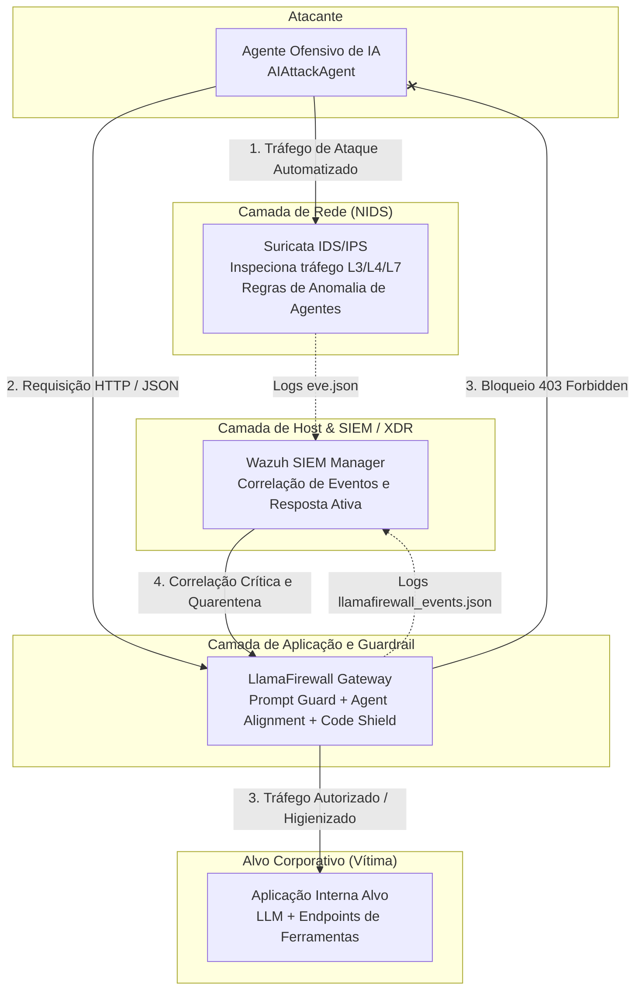

# Arquitetura de Mitigação de Ataques Cibernéticos Automatizados por Agentes de IA

**Projeto Integrador / Segurança da Informação**  
**Instituição:** Centro Universitário Unieuro  
**Autores:** Gabriel Nascimento Feitosa Breguedo, Ícaro Cardoso da Silva, Matheus Nery Walkowicz, Miguel, Yuri Bacelar de Almeida  
**Ano:** 2026  

---

## 1. Visão Geral da Arquitetura

A arquitetura adota o princípio de **Defesa em Profundidade (Defense-in-Depth)** combinando ferramentas Open Source em três camadas essenciais:

---

## 2. Componentes e Papéis

### A. LlamaFirewall (Camada de Aplicação / Guardrail de IA)
* **Objetivo:** Impedir que comandos de manipulação cognitiva ou vetores adversariais alcancem o modelo de linguagem ou executores de ferramentas.
* **Scanners implementados:**
  1. **Prompt Guard:** Classificador de injeção de prompt direta e indireta, jailbreaks (DAN, Developer Mode) e exfiltração de diretrizes de sistema.
  2. **Agent Alignment:** Auditoria de intenção e integridade de chamadas de ferramentas (*tool calling*), bloqueando *Goal Hijacking* e execução de comandos de terminal não autorizados (`shell_exec`, scripts arbitrários).
  3. **Code Shield:** Análise estática online contra geração e injeção de scripts maliciosos (Reverse Shells, comandos destrutivos `rm -rf`).
* **Modo de Operação:** Reverse Proxy em escuta na porta `8080`, encaminhando tráfego higienizado para o alvo na porta `8000`.

### B. Suricata (Camada de Rede / NIDS/IPS)
* **Objetivo:** Inspecionar o fluxo de pacotes na interface de rede identificando assinaturas de agentes autônomos, taxas anômalas de requisições e payloads em trânsito.
* **Assinaturas implementadas (`ai_agent_attacks.rules`):**
  * SIDs 1000001–1000003: Injeções de prompt e jailbreaks trafegados em texto claro sobre HTTP.
  * SIDs 1000004–1000005: Extração e comandos automatizados via parâmetros de ferramentas.
  * SID 1000006: Identificação de User-Agents pertencentes a bots/agentes ofensivos.
* **Saída de Dados:** Formato padrão EVE-JSON (`/var/log/suricata/eve.json`).

### C. Wazuh (Camada de SIEM / Correlação e Resposta)
* **Objetivo:** Centralizar, analisar e correlacionar telemetria de segurança proveniente do Suricata e do LlamaFirewall.
* **Decodificadores e Regras (`local_rules.xml`):**
  * **Regras 100201 a 100203:** Classificação de incidentes com severidade 10 a 12 de acordo com a taxonomia MITRE ATT&CK (T1059, T1078).
  * **Regra 100210 (Severidade 14 - Crítica):** Correlação temporal; múltiplos ataques originados pelo mesmo agente/IP geram alerta de incidente crítico e acionam resposta ativa.

### D. Aplicação Alvo (Vítima)
* Microsserviço corporativo em FastAPI simulando um assistente interno conectado a ferramentas e banco de dados SQLite.
* Sem proteção, é 100% vulnerável à exfiltração de chaves e execução indevida.

### E. Agente Atacante de IA (AI Attacker)
* Simula um agente ofensivo autônomo baseado no incidente relatado pela OpenAI (Hugging Face, 2026).
* Percorre automaticamente um dataset com múltiplos cenários de ataque e casos de controle benignos (para validação estatística de falsos positivos).

---

## 3. Critérios de Avaliação e Hipóteses

| Métrica | Definição | Fórmula | Meta Científica |
| :--- | :--- | :--- | :--- |
| **Taxa de Detecção ($T_D$)** | Percentual de ataques identificados | $\frac{Ataques\ Detectados}{Total\ de\ Ataques} \times 100$ | $\ge 90\%$ |
| **Taxa de Bloqueio ($T_B$)** | Percentual de ataques barrados antes da execução | $\frac{Ataques\ Bloqueados}{Total\ de\ Ataques} \times 100$ | $\ge 90\%$ |
| **Taxa de Falsos Positivos ($FP$)** | Requisições legítimas bloqueadas indevidamente | $\frac{Legitimos\ Bloqueados}{Total\ de\ Legitimos} \times 100$ | $\le 5\%$ |
| **Sobrecarga de Latência** | Tempo adicional inserido pelas defesas | $Tempo_{Protegido} - Tempo_{Baseline}$ | $< 500\text{ ms}$ |
